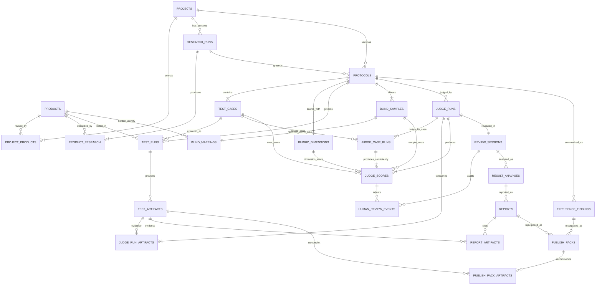

# AI Benchmark Studio 数据库 Schema v1

## 设计目标

本 Schema 将一次测评保存为可追溯的数据链：

`Project → Research → Protocol → TestRun → Artifact → Experience Findings → Publish`

专业测评作为可选支线保留：

`Artifact → Blind Judge → Human Review → Final Result Analysis → Report → Publish`

原则：

- Postgres 是业务状态的唯一事实来源；Project progress 由 `test_runs` 推导。
- 重要运行采用 append-only 或新 version，不覆盖历史。
- locked Protocol 及其 TestCase、Rubric 不可原地修改。
- AI Judge 原始评分不可修改；人工复核只追加事件。
- Reveal 前后普通客户端均不能直接读取 `blind_mappings`。
- `experience_findings` 直接绑定当前 locked Protocol 和完整 Artifact-backed TestRun 矩阵；人工确认后可直接进入 Publish。
- Report 仍绑定有效 ResultAnalysis；PublishPack 必须且只能绑定 `findings_id` 或 `report_id` 其中一个；配图必须绑定同一 Protocol 的真实图片 Artifact。

迁移文件：`supabase/migrations/202608170001_initial_benchmark_schema.sql` 与后续按时间排序的增量 migrations。

## 表与职责

| 表 | Source of Truth | 关键约束 |
|---|---|---|
| `projects` | 项目基本信息与流程状态 | owner；软删除；不保存 progress |
| `products` | 可复用产品实体 | `normalized_name` 唯一；项目删除不级联删除产品 |
| `project_products` | 项目选择的 1–3 个产品 | `(project_id, product_id)` 唯一；`display_order` 1–3 且唯一 |
| `research_runs` | 每次 AI Research 运行 | `(project_id, version)` 唯一；保留 input/model/prompt/error |
| `product_research` | 某次 Research 的逐产品结论 | 必须同时属于该 Project 和 ResearchRun |
| `protocols` | Protocol 版本与锁定状态 | `(project_id, version)` 唯一；引用具体 ResearchRun |
| `test_cases` | Protocol 的动态 Test Cases | 顺序唯一；保存 expected output 与 evidence requirements；locked 后不可变 |
| `rubric_dimensions` | Protocol 的动态 Rubric | 权重 `> 0, <= 100`；锁定时总和必须为 100 |
| `test_runs` | `Protocol × TestCase × Product` | 三元组唯一；只能为 locked Protocol 创建 |
| `test_artifacts` | 原始证据 metadata | Storage path 唯一；image/PDF/text/video；写入后不可变 |
| `blind_samples` | 客户端可见的 Sample label | 每个 Protocol label 唯一 |
| `blind_mappings` | Sample → Product 的真实映射 | server-only；每个 Protocol 的 Product 只映射一次 |
| `judge_runs` | 一次 Protocol 级 Blind Judge 批次 | 绑定 locked Protocol、完整 Artifact 集与批次输入签名 |
| `judge_case_runs` | 批次内单个 TestCase 的 AI 路由 | 每个 Case 唯一；provider/model/prompt/input immutable；server-only |
| `judge_run_artifacts` | JudgeRun 使用的证据集合 | Artifact 必须属于相同 Project/Protocol |
| `judge_scores` | AI 原始逐项评分 | `Case × Sample × Rubric` 唯一；0–10；不可更新/删除 |
| `review_sessions` | 人工复核状态 | 只允许 `reviewing → locked → revealed` |
| `human_review_events` | 人工 override/revert 历史 | append-only；override 理由必填；只允许复核期写入 |
| `experience_findings` | 快速测评的证据化发现 | 来自完整 TestRun / Artifact；AI 输出与人工确认稿分离；不保存评分 |
| `result_analyses` | Reveal 后最终分析 | 绑定 ReviewSession 和 `final_score_signature` |
| `reports` | 深度报告 | 只能绑定 completed 且非 stale 的 ResultAnalysis |
| `report_artifacts` | 报告证据引用 | 只能引用 ResultAnalysis 同一 Protocol 的真实 Artifact |
| `publish_packs` | 社区选题、配置与帖子 | 二选一绑定人工确认后的 Findings 或 completed Report；Quick Publish 不依赖 Judge / Review / Report |
| `publish_pack_artifacts` | 社区截图推荐 | 可选；有配图时只允许同 Project/Protocol 的 image TestArtifact，顺序 1–9 |

三张 Artifact 关联表用 FK 取代不可校验的 JSON ID 列表：`judge_run_artifacts` 固化 Judge 输入，`report_artifacts` 固化报告证据，`publish_pack_artifacts` 固化社区截图。Report/Publish 引用还必须与 ResultAnalysis 属于同一 Protocol。

## ER



## 状态与版本

### Research

- 每次运行创建新的 `research_runs.version`。
- 状态：`pending → running → completed | failed`。
- failed run 保留 error；retry 创建新 run，不覆盖旧 run。
- 项目进入 Protocol、测试、评分或发布阶段后仍可主动重新调研；新 ResearchRun 开始后项目回到 `researching`，旧 ResearchRun 与下游产物保留为历史。
- completed 前必须包含当前 Project 的全部产品；完成或失败后 run 与逐产品输出不可再修改。
- `projects.evaluation_mode` 保存 quick / professional；`quick_preparation_status/error` 保存快速方案自动准备的可恢复状态。
- `product_research_snapshots` 是产品级不可变版本，保存能力、限制、输入输出格式、来源、AI 路由、签名和有效期。
- Project 仍以自己的 `product_research` 作为协议输入；复用时通过 `snapshot_id` 固定引用并设置 `reused_from_snapshot=true`，`research_runs.reuse_details` 记录复用、过期及新调研明细。

### Protocol

- Protocol 必须引用具体 `research_run_id`。
- 多产品项目只有 completed 且可比性为 comparable/partially comparable 的 ResearchRun 才能创建 Protocol。
- 单产品项目保留 Comparability 兼容字段，但不以其 status 阻塞体验 Protocol；快速模式默认生成 1 个可留证核心 Case，历史多任务版本继续保留。
- 新版本先以 `draft` 创建；数据库拒绝直接插入 locked Protocol。
- 项目进入测试、评分、报告或发布阶段后仍可创建新的 Protocol version；旧 Protocol、TestRun 与后续产物保留为历史，新版本创建后项目回到 `protocol_draft`。
- Lock 时数据库检查：至少 1 个 TestCase、至少 1 个 Rubric、Rubric 总权重恰好 100。
- locked 后 Protocol、TestCase、Rubric 的 UPDATE/DELETE/INSERT 均被 trigger 阻止；修改方案必须创建新 version。

### Quick Findings

- 完整 `Product × TestCase` TestRun 矩阵确认后，快速模式自动初始化 Blind Layer、运行 Judge，并默认接受高置信度正常评分；异常项经一次人工处理后 Lock / Reveal。
- 快速链路允许先完成 Findings 与社区发布；项目处于 `completed`、`reported` 或 `published` 时均可在后台补齐可选的专业分析。
- AI Findings 只输出 `good / neutral / problem` 三类可观察发现，每条必须绑定同一产品、同一 TestCase 的真实 Artifact。
- AI 生成完成不等于快速测评完成；只有用户确认或修改 Findings 后，项目才进入快速测评完成态。
- 人工确认稿作为社区内容的编辑主线，不覆盖 AI 原始 Findings；已确认记录不原地改写。
- PublishPack 可直接绑定 `findings_id`；最终社区内容事实核对会重新读取原始 Artifact，避免二次摘要持续放大错误。
- PublishPack source trigger 按 `report_id` 或已人工确认的 `findings_id` 校验来源，并拒绝原地修改来源及版本。

### Review

- ReviewSession 创建时必须绑定 completed JudgeRun，并从 `reviewing` 开始。
- 唯一合法迁移为 `reviewing → locked → revealed`。
- 只有 `reviewing` 状态可追加 HumanReviewEvent；locked 后分数不再变化。
- Reveal 只改变身份可见状态，不改变已锁定 Final Score。

### Judge

- JudgeRun 只能绑定 locked Protocol，且 BlindSample/Mapping 必须一一覆盖项目产品。
- 每个 TestCase 必须创建唯一 JudgeCaseRun；同 Case 的全部 Blind Samples 共享其 provider/model/promptVersion/inputSignature。
- 全部 Artifact 为 `text/plain` 才路由 text-only Judge；任一图片、PDF、视觉文件或混合类型会把该 Case 全部 Sample 路由到多模态 Judge。
- 从 pending 进入 running 前，必须存在完整 `Product × TestCase` TestRun 矩阵；所有 TestRun 必须 ready，并为本 JudgeRun 绑定至少一个真实 Artifact。
- completed 前必须存在每个 TestCase 的 completed JudgeCaseRun，以及完整 `Case × Sample × Rubric` JudgeScore 矩阵。
- JudgeScore 与 JudgeRun 使用的 Artifact 集均不可修改；重试创建新的 `attempt`。
- AI Run 保存 provider/model/token/latency/cost；Provider 内部 reasoning/thinking 不入库。

## Final Score 与人工审计

`judge_scores.ai_score` 永久保存 AI 原值，UPDATE/DELETE 会被数据库拒绝。

`human_review_events` 只追加：

- `override`：保存一位小数的 0–10 分数，理由必填。
- `revert`：必须指向当前生效的 override，恢复 AI Score。
- 多次 override 均保留；全局 `event_sequence` 用于审计，按评分项串行生成的 `score_revision` 决定生效顺序，避免并发复核产生歧义。

`review_final_scores` 是 Final Score 的唯一计算视图：

```text
latest event = override → final_score = override_score
latest event = revert / no event → final_score = ai_score
```

不保存第二份可漂移的 overall score。产品综合分在应用层按 locked Rubric 权重从该视图计算。

`private.final_score_signature(review_session_id)` 对全部 `judge_score_id:final_score` 排序后计算 SHA-256。ResultAnalysis 可按 `attempt` 重试，但每次插入或更新时数据库都要求：

1. ReviewSession 已 revealed；
2. 保存的 signature 等于当前 Final Score signature。

Report 创建时会再次检查 ResultAnalysis completed 且 signature 仍然有效，避免只换数字却沿用旧 winner reason、strengths 或 recommendation。

## Blind Security

Blind 分为两层数据：

- `blind_samples`：Sample A/B/C，可提供给 Judge 和 Review 客户端。
- `blind_mappings`：Sample 与真实 Product 的关系，只能由可信服务端读取。

安全边界：

- 所有表启用 RLS。
- `blind_mappings` 对 `anon` / `authenticated` 撤销全部权限，且不创建任何 RLS policy。
- `test_artifacts`、`judge_runs`、`judge_case_runs`、`judge_run_artifacts`、`report_artifacts` 与 `publish_pack_artifacts` 同样不开放客户端直查，避免通过 Artifact 关联反推出 Sample 身份。
- Review/Judge 的普通查询只返回 Sample ID/label，不能 join Mapping。
- Reveal 必须走 server-only Service；服务端先验证 ReviewSession 为 `revealed`，再按需返回揭晓结果。
- Service Role 只能存在于 server-only 模块，不进入浏览器 bundle。

RLS 不是 UI 隐藏。即使用户直接调用客户端 Supabase Query，也无法读取 Mapping。

## Storage 与证据链

私有 bucket：`benchmark-artifacts`

路径：

```text
projects/{projectId}/runs/{testRunId}/{artifactId}.{ext}
```

限制：

- 单文件上限 50 MB。
- MIME：PNG、JPEG、WebP、PDF、TXT、Markdown、JSON、CSV、MP4、WebM、QuickTime。
- bucket 不公开，M1 不给 `anon` / `authenticated` 创建 `storage.objects` policy。
- M6 由可信服务端校验 Project 与 Blind 状态后签发短期 URL。
- Postgres 只保存 path、filename、MIME、size、preview path、hash、metadata，不保存永久公网 URL。
- Artifact metadata 写入后不可修改；错误上传通过新增 Artifact 和 TestRun 状态表达，不覆盖原始证据。

这遵循 Supabase 的私有 bucket 与 RLS 模型；service role 可绕过 RLS，因此必须只在服务端使用。参考：[Row Level Security](https://supabase.com/docs/guides/database/postgres/row-level-security)、[Storage Access Control](https://supabase.com/docs/guides/storage/security/access-control)、[Storage Ownership](https://supabase.com/docs/guides/storage/security/ownership)。

## RLS 与写入边界

- `authenticated` 仅获得所属 Project 的 blind-safe 表 SELECT。
- `anon` 不获得业务表权限。
- 所有真实写操作暂定由 M2 的 server-only repository 使用 Service Role 完成，并在 Service 层验证用户/项目权限。
- `blind_mappings` 不提供普通客户端 SELECT，即使 revealed 后也只通过收敛的服务端响应揭晓。
- Artifact metadata、Judge input snapshot、JudgeRun–Artifact 关联和 Storage 原始对象都不开放客户端直接列举；由 server-only Service 返回与当前阶段匹配的最小投影。

Auth 在后续接入。`projects.owner_id` 可为空是为了允许第一阶段由服务端创建项目；接 Auth 后写入真实 `auth.users.id`。空 owner 的记录不会被普通 authenticated RLS 查询读取。

## Delete Strategy

- `projects.deleted_at` 为软删除入口。
- 全局 `products` 只归档，不因 Project 删除而 cascade。
- 核心 FK 使用 `ON DELETE RESTRICT`，避免误删 Protocol、Artifact、Judge、Review 与报告历史。
- Auth 用户删除时，`owner_id/actor_id/created_by` 使用 `SET NULL`，保留实验与审计记录。
- M1 不执行任何真实数据库 reset 或破坏性迁移。

若未来需要永久清除整个项目，应实现单独的管理员维护流程：先删除 Storage 对象，再按明确依赖顺序清除数据库记录，并记录操作审计；不能依赖无差别 cascade。

## TypeScript 映射

`lib/types/database.ts` 提供：

- `Json`
- 所有核心表的 Row 类型
- `DatabaseTableName` / `TableRow<T>`
- 常用状态联合类型
- `ReviewFinalScoreRow` 视图类型

`lib/types/database.generated.ts` 由已应用 migrations 的本地或远端 Catalog 生成，`lib/types/database.ts` 在其上叠加业务状态联合类型；迁移是最终数据库权威来源。官方建议将 migrations 纳入版本控制，并从 Schema 生成 TypeScript 类型：[Local development with schema migrations](https://supabase.com/docs/guides/local-development/overview)。

## 验证边界

M1 初始化 migration 已在空的远端项目执行并通过 Schema lint；每个增量 migration 必须先 dry-run，再应用、lint 并重新生成 TypeScript 类型。本机尚无容器运行时，因此本地全量 reset 仍待 Docker/Podman 可用后补跑；任何破坏性远端 reset 仍需单独确认。


### Publish 内容机制调整（2026-09-09）

Publish 不新增表或 migration。publish_packs.community_post.attemptAudit 保存当前版本追加的任务事件（started / response / completed / failed）；ready 写入时保留该字段，failed 保留现有 JSON。写入采用状态与 updated_at 比较，拒绝并发覆盖及已结束版本修改。对浏览器仍投影旧的公开文章字段，不发送完整审计输入。

## 后台快速模式（2026-09-30）

新增非破坏性 migrations `20260928180649_quick_backend_workflow.sql`、`20260928181719_quick_workflow_continuations.sql`。

- `quick_jobs`：Project 外键 RESTRICT；kind/scope/payload、queued/running/completed/failed/cancelled、attempts、lease_token/lease_until、available_at、stage/error/result。`(project_id,kind,scope)` 唯一，运行态必须同时具有 lease；索引覆盖可调度任务与项目历史。
- `quick_job_steps`：`(job_id,step_key)` 主键，FK RESTRICT；保存验证成功的结构化结果和 route/usage，无 chain-of-thought。只允许新增与读取，重复检查点不覆盖。
- 两表开启 RLS，撤销 anon/authenticated/public 权限，只由 Service Role 服务端访问。四个 invoker RPC 的 search_path 为空，普通角色没有 EXECUTE。
- `enqueue_quick_job` 检查未归档 quick Project；`claim_quick_job` 领取/回收、同项目互斥；`save_quick_step` 校验有效 lease；`finish_quick_job` 原子完成并创建后继任务。正常 continuation 不增加失败次数。
- Project 软删除后不再领取任务；不清除已有历史记录。原有 Protocol/Artifact/Judge/Human Review/Final Score 表与删除策略保持不变。

## Production quick-worker scheduler

`quick_worker_scheduler` migration 启用 `pg_cron`、`pg_net`，新增仅数据库调度角色可执行的 `private.dispatch_quick_worker()`（SECURITY INVOKER，空 search_path；PUBLIC/anon/authenticated/service_role 无 EXECUTE）。任务 `benchmark-quick-worker` 每 30 秒检查未归档快速项目的到期任务，遵守同项目 lease；满足条件且 Vault 配置齐全才调用正式站点。Vault 的 origin/secret 在部署时单独配置，不进入 migration。HTTP 仅发送调度认证头，不发送实验资料；不更改现有业务表、评分或审计。

## 显式产品身份（2026-10-03）

Migration `20261002170736_product_library_identity.sql` 只替换 `create_benchmark_project` 的两个重载，不改表结构、不迁移或重写历史实验。`p_products` 的每项可携带 `productId`；指定时锁定并校验 active 产品，用数据库名称/官网创建项目关联。未指定时按现有 normalized_name 唯一约束复用，禁止官网冲突及同一项目重复产品 ID，且不再 upsert 覆盖已有产品字段。

错误码：P1001 同名官网冲突、P1002 产品不存在/已归档、P1003 同项目重复产品。项目与关联仍在同一事务内创建。五参数重载保留显式模式，四参数兼容入口保留 quick + idle 状态。均 SECURITY INVOKER、空 search_path，仅 service_role 可执行。没有新增客户端查询权限。`tests/product-identity.contract.sql` 使用 service_role 角色在回滚事务内验证身份、不可变字段、失败原子性及权限。

## 产品库可恢复删除与收录

复用既有 products.archived_at，无新增 migration。服务端删除/恢复只更新目标产品的 archived_at（既有 updated_at trigger 仍运行），以当前归档状态做条件更新并检查返回行，失败不假报成功。收录读取 test_runs 与 test_artifacts 的内连接，排除 invalid run 和零字节 Artifact，再与未归档、非内部验证的 project_products/project 关联匹配；仅返回产品/项目 ID，不向客户端投影证据或 Blind Mapping。空档案不做物理清理，产品归档不改变 FK、Storage 或历史实验。

## 测评名称唯一约束

`20261003102310_unique_project_names.sql` 新增部分唯一表达式索引 `projects_active_name_unique`：`lower(btrim(regexp_replace(name, '[[:space:]]+', ' ', 'g')))`，条件 `deleted_at is null`。适用于当前单工作区模型；创建、修改名称及恢复均由同一索引原子防重。上线前确认没有存量冲突，不重命名或删除历史行。无新表/字段、RPC 或权限变更，生成的 TypeScript Row 类型无需变动。

重命名仍按 Page → Action → Service → Repository → DB；仅更新指定 active Project 的 name，updated_at 由既有 trigger 更新。`tests/project-name.contract.sql` 在 service_role 下回滚验证重复 INSERT/UPDATE、大小写/空白、保存原名、已删除名称复用、恢复冲突和其他字段不变。

### 2026-10-04 社区内容规范元数据（无 DDL 变更）

`publish_packs.community_post` JSON 新增可选 `writingPlan`、`contentPolicyVersion`；补齐 `contentBrief`、`languagePass` 的仓储透传，继续保存 `styleEdit`、`stylePreservation`、`articleReview` 与 `generationTrace`。新结果为四阶段，trace 增加 `content_check`；历史结构保持兼容。复用原子 `complete_publish_pack` 与不可变 ready 版本规则，无新增表、RPC、权限或 migration。成功后台阶段仍存 `quick_job_steps`，语义审查失败不能执行完成 RPC。

`get_workflow_navigation_snapshot(project_id)` 是只读、`stable`、`security invoker` 的聚合 RPC，用一次数据库往返返回工作流解锁所需的跨阶段最小状态，替代页面原有的 13 次 REST 查询。函数不返回 Blind Mapping、Judge 原始输入或评分内容；`public`、`anon`、`authenticated` 均无执行权限，仅服务端 `service_role` 可调用。

`refresh_publish_pack_title` 只允许 service role 对当前最新 ready PublishPack 操作。函数锁定 Findings/Report 来源，创建下一版本，复制配置、选题、正文 JSON 与全部 `publish_pack_artifacts`，仅替换标题并追加 `titleRefreshes` 审计；随后按 `draft → generating → ready` 经过既有状态机。旧 PublishPack 不更新，文本文章仍允许零截图。

### 2026-10-05 Artifact 签名直传（无 DDL 变更）

上传继续使用私有 `benchmark-artifacts` bucket 与既有 `projects/{projectId}/runs/{testRunId}/{artifactId}.{ext}` 路径。服务端签发单次上传 URL，浏览器直传完成后才调用既有 `record_test_artifact`；确认阶段以 Storage 实际对象核验大小、MIME、文件头和文本 SHA-256。校验或记录失败会删除孤立对象，重复确认按 storage path 返回已有 Artifact。没有新增表、字段、RPC、客户端数据库权限或公开 bucket。


### 视频证据脱敏（2026-10-11）

Migration `20261011143643_redact_video_judge_evidence.sql` 仅新增 RPC，不增加表或改历史记录。`redact_video_judge_evidence(judge_run_id,test_case_id,content)` 为 security invoker、空 search_path，仅 service_role 可执行；验证 running JudgeRun、Locked Protocol 和所属 Case，限 2MB 文本，数据库内对本项目产品名、官网/域名脱敏，不返回真实身份或 Mapping。VideoEvidence derivative JSON 与预处理 JPEG/WAV base64 保存在既有私有 `benchmark-artifacts/media-cache/`，关联原 Artifact ID/hash/policy/context/router 签名；binary 不进入 PostgreSQL。快速媒体失败只写独立 quick_job_steps degraded 记录，不写 judge_scores。

`20261011153000_isolate_quick_e2e_workers.sql` 保留 claim_quick_job 的签名、角色和 lease/锁语义，只让保留的 `[E2E]` 测试项目必须由指定 project_id 的工作端领取，避免生产 Cron 使用真实 Provider 执行测试夹具。没有改表、删除用户数据或覆盖历史。E2E poller 通过专用测试环境变量限定自己的项目；普通项目队列不受此过滤影响。


### 2026-10-12 文章保存与后台重生成

非破坏性migration `20261012082020_publish_editor_revisions.sql` 新增service-role-only、security invoker函数 `create_publish_revision(projectId, sourcePackId, mode, copy, recommendations)`，无新表。锁定Project及源Report/Findings并校验最新版本；manual从draft→generating→ready保存新文案/可选真实截图关联，旧ready保持immutable。JSON manualEdit包含sourcePackId/savedAt/aiReviewed=false，源AI追溯字段保留但不是本次模型调用。regenerate原子创建draft及quick_jobs，JSON regeneration含sourcePackId/jobId/requestedAt；job payload绑定新packId，成功后生成审计替换旧稿。失败/死worker retry创建下一版本，只有failed job可重试。claim_quick_job仅对显式publish/regenerate扩展专业项目，保留quick任务边界、项目串行、lease、SKIP LOCKED和E2E排除。Artifact来源/图片种类/FK/unique仍由现有trigger约束，保存后失效正文锚点置null。
