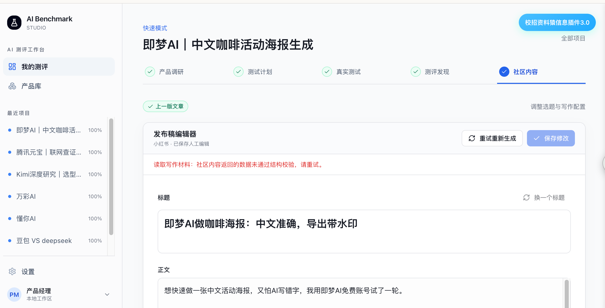
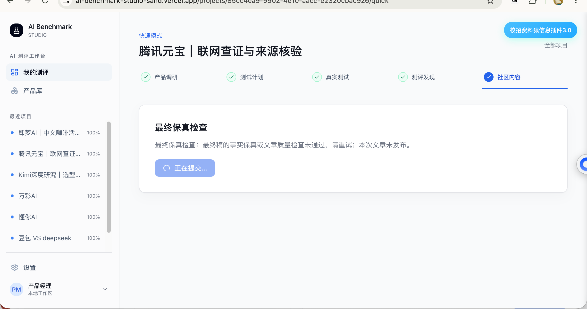

# AI测评内容生产工作台

AI产品经理作品集 · AI Benchmark Studio

## 01 需求与产品方案

### 项目概况

面向内容编辑，将产品调研、测试方案、人工实测、证据整理和社区写作串成工作流，输出有原始材料支撑、可编辑的测评文章。

项目由我与 Codex 协作落地。我参与需求拆解、流程与质量规则设计、样稿反馈及验收，Codex 辅助方案细化、开发与工程验证。原项目为2026年8–9月，本文包含持续至10月的个人迭代。

### 需求分析

业务起点是36氪AI测评网冷启动时的内容供给需求：需要补充测评文章，人工写手成本高、质量一般。目标是在维持基础内容质量的前提下，降低单篇可采用文章的生产成本。

| 工作中的问题 | 产品需求 | 优先级 |
| --- | --- | --- |
| 调研、实测和写作材料分散，反复整理 | 统一任务、原始证据与稿件，减少重复输入 | P0 |
| AI会编造经历、混淆任务要求与实际结果 | 证据约束、人工确认、独立审核 | P0 |
| 各产品输入条件不同，评分依据不一致 | 执行前锁定方案，按任务制定评分标准 | P0 |
| 长流程等待多，刷新或失败后容易重复生成 | 后台执行、阶段保存、有限重试和新版本 | P1 |

需求依据为实际业务场景和使用反馈；用户访谈、人工稿费用及工时基线尚未系统采集。

### 产品范围与取舍

MVP支持1–3款产品。快速模式默认一个核心任务，采用方案后由人实测、上传原始结果，再确认发现并生成文章。专业模式保留多任务、完整复核与报告；报告后置，避免阻塞成稿。

采用“固定工作流＋人工关口”：可重复的整理和写作交给AI，真实测试、关键发现与最终采用交给人。保留实测成本和事实检查，暂不自动操作第三方产品或自动发布到社区。

目标指标是任务可采用率、每篇采用稿的综合成本和人工编辑工时。业务目标是否达成，仍需同口径对照。

线上产品：[AI Benchmark Studio](https://ai-benchmark-studio-sand.vercel.app/projects)。

<!-- page -->

## 02 模型选择与可信度设计

### 按任务和模态配置模型

| 任务 | 2026-10-16 默认配置 | 选择依据与边界 |
| --- | --- | --- |
| 检索与资料整理 | 智谱 search-prime＋glm-5.2 | 先获取来源，再整理事实，未知信息不凭记忆补齐 |
| 可比性、方案、文本评分与分析 | DeepSeek deepseek-v4-pro | 承担分析与结构化判断；复杂任务按需使用较高推理强度 |
| 选题与写作规划 | DeepSeek deepseek-v4-pro | 先判断证据是否足以支撑主线，再交给写作模型 |
| 正文、标题、修订与文本审稿 | DeepSeek deepseek-v4-flash | 写作使用非思考模式；控制复杂度，具体质量与成本优势待对照 |
| 图片理解、多模态评分及发现 | 智谱 glm-4.6v | 直接读取视觉证据；视频先解码和取帧，不能据稀疏帧评价整片 |
| 专业报告 | 智谱 glm-5.2 | 组织已确定的分析和证据，不重新判分或改变排名 |

上表保留作品集交付时的配置快照。2026-10-17 用户指定后，正文、标题与按需修订切换为 Moonshot `kimi-k3`，独立文本审稿仍为 DeepSeek；环境变量可覆盖；历史调用以实际模型与Prompt审计为准。分工已落地，统一模型对照尚待完成。

### 如何完成选型验证

先比较写作节点：冻结同一Brief和证据，当前配置与一个具备相应能力的候选配置分别生成，隐藏模型身份做人工盲评。建议每任务每配置3次，按任务汇总全部输出；质量底线通过后，再比较采用、成本和耗时。统一对照尚待运行。

审核器单独测试正常稿、历史错误稿和人工挑战稿，分别统计漏检与误拦截。不能因候选审核更宽松，就认定写作质量提升。

### 准确性与幻觉控制

- 输入端：区分产品声称、任务要求、实际结果和作者判断；写作只接收相关原始材料及确认发现，不把报告排名直接扩成正文。
- 生成端：用Schema约束字段和引用；禁止新增无依据的经历、数字与收益，证据不足时缩小结论或停止。
- 审核端：只读初审定位到当前稿件原句，必要时定向修订一次，再独立核验最终全文；不合格不保存为ready。
- 运行端：统一服务端路由，记录输入签名、模型、Prompt、输出与错误；同供应商有界修复，不静默切换供应商或回退假数据。

原始回答支持某句话，只能证明材料一致性；价格、能力等外部事实仍须核查来源。模型审核可能漏检或误判，人工确认不可省略。

<!-- page -->

## 03 工作流与节点评测

主流程：目标 → 调研 → 锁定方案 → 人工实测 → 证据读取 → 匿名评分 → 复核揭盲 → 确认发现 → 写作与审核 → 人工采用。

专业分析与报告从最终评分分支生成，不阻塞快速写作。

| 阶段 | 输入 → 输出 | 已有验收要求 | 节点效果评测设计 |
| --- | --- | --- | --- |
| N00 项目与目标 | 意图、1–3款产品 → 项目、模式 | 字段和身份合法；保存后刷新可读 | 合法、冲突及重复提交用例；人工检查目标能否转为具体任务 |
| N01 调研与可比性 | 产品、官网、意图 → 资料、来源、共同能力 | 来源来自检索；未知明确；可比性基于已存资料 | 关键主张支持、资料时效与覆盖；对照独立人工可比性判断 |
| N02 方案与锁定 | 资料、输入限制 → 任务、Prompt、评分标准 | 权重合计100%；输入可执行；看结果前锁定，修改建新版本 | 人工检查相关性、可执行、可留证、可评分；记录被迫改Prompt的任务 |
| N03 人工实测 | 锁定方案、产品 → 原始文件或文本、执行记录 | 同任务同条件；每个测试有有效证据；不生成替代截图 | 测上传、半成功和重试；抽查执行一致性与记录完整性 |
| N04 证据读取 | 原始文本、图片、PDF或视频 → 可追溯内容与限制 | 引用与哈希可核对；视频最多12帧；ASR当前未接入，不评价声音 | 对照原始材料标注观察正确与遗漏；解析成功和语义正确分别统计 |
| N05 匿名评分 | 锁定标准、匿名样本、证据 → 维度分、理由、引用 | 分数0–10，矩阵完整；同任务模型配置一致；原始AI分不可覆盖 | 独立人工先盲评，再比较维度分偏差、排序和重复稳定性 |
| N06 复核与揭盲 | 匿名分、异常项 → 最终分、纠偏事件、揭盲状态 | 理由必填；只改具体维度；先锁定后揭盲；保留修改审计 | 越序访问、改分与恢复用例；抽查自动接受项是否遗漏错误 |
| N07 发现确认 | 实测证据、上下文 → 观察、影响、限制 | 观察与解释分开；引用归属正确；人工确认后才写作 | 逐项标支持、矛盾或无法核验；检查遗漏与过度概括 |

“已有验收”是当前机制；“效果评测”是待统一执行的量化设计。各项标通过或失败并记录原因，节点通过率以全部有效运行作分母。每个AI节点既用合格固定输入测自身能力，也用真实上游输出测误差传播。

<!-- page -->

## 04 写作节点与交付验收

| 阶段 | 输入 → 输出 | 已有验收要求 | 节点效果评测设计 |
| --- | --- | --- | --- |
| N08 选题与Brief | 确认发现、证据、偏好 → 候选角度、写作主线与边界 | 观点有据、主次合理；比较有共同任务；引用无效不继续 | 人工检查读者问题、证据分量及选题价值；记录拒选原因 |
| N09 初稿 | Brief、事实、原始细节 → 标题、正文、标签、互动句 | 遵守字段和渠道规则；标题具体；不编造亲历、数字或收益 | 固定输入盲评事实支持、问题回答、具体细节和表达；记录编辑负担 |
| N10 只读初审 | 实际稿件、材料 → 质量判断、定位问题与修改指令 | 引文逐字属于当前稿；拒绝有具体原因；不替写正文 | 正常稿与错误稿同时测；统计漏检、误拦截和定位正确性 |
| N11 定向修订 | 原稿、问题、同一证据 → 修订标题、正文、互动句 | 仅有问题时运行；一次业务修订；来源元数据由程序保留 | 人工比较问题修复、新增错误与无关改动；保留失败修订 |
| N12 最终审核 | 最终全文、原稿、证据 → 审核结果、新文章版本 | 审核对象与保存稿一致；事实或质量不通过不能ready；配图来自真实证据 | 抽查实际保存稿的误放行、范围漂移和截图对应性 |
| N13 编辑与采用 | 成稿、人工修改 → 新版本、复制稿 | 保留旧稿；手工稿不继承AI已审标记；人决定是否发布 | 拟补采用事件、原因和编辑工时；ready与复制不直接算采用 |
| N14 专业分析与报告 | 最终分、证据、审计 → 分析、专业报告 | 分数签名一致；不改评分与排名；专业失败不影响已有文章 | 程序核对数值与版本；人工检查解释支持、建议范围和限制 |

### 输入输出的关键契约

审核问题包含“字段、原句、问题类型、原因、修改指令”，必须指向实际稿件。修订只返回标题、正文、互动句，不能改评分、素材或证据归属。每次新生成创建新版本，旧成稿和原始实测保持。

### 人的判断与自然表达

作者可补充真实用途、关注点、取舍和选择；模型据此表达有限判断，不能代填经历。评测时检查细节是否来自原始材料、段落是否推进、是否重复免责或空泛总结；“像人写的”不靠编造亲历实现。

### 失败处理

任务保存待处理、运行、完成或失败状态，支持阶段恢复；不同版本绑定各自任务。结构修复与业务改写分别计次，不无限循环审核到随机通过。前台错误应指出阶段与可执行动作；部分提示细化仍待完善。

当前选题Schema要求1–6个候选，与规范允许0个存在差异；资料不足的主动拒写能力仍需补齐，不能为了成稿而凑观点。

<!-- page -->

## 05 端到端评估与业务验收

### 以采用稿为最终结果

工程完成、AI审核通过和编辑采用分别记录。拟定人工采用线：事实底线通过，“回答读者问题、具体细节、表达结构”三项各按0–3分标注，均至少2分，且编辑确认采用。该标准需试标校准，尚非已取得的成绩。

事实底线单独判定：不捏造测试、经历、数字或来源；重要断言有材料支持，无法核验则缩小范围。文风高分不能抵消事实错误。

| 指标 | 计算口径 | 解释边界 |
| --- | --- | --- |
| 首次链路成功率 | 首轮即得到合格最终稿的任务数 ÷ 有效启动任务数 | 含失败、拒绝与超时；取消和无效输入另列 |
| 预算内成功与采用 | 规定尝试内成功任务数、采用任务数，分别 ÷ 同批启动任务数 | 单任务多版本不重复加分母；同时报告尝试预算 |
| 主张支持率 | 材料支持的可核验主张数 ÷ 人工审查的可核验主张总数 | 矛盾和无法核验分别列出；不是外部事实正确率 |
| 审核漏检与误拦截 | 有问题却放行 ÷ 人工判有问题；可用却拒绝 ÷ 人工判可用 | 正常、真实错误和人工挑战稿分开；不用模型自审当答案 |
| 单篇采用成本 | 本批全部生产投入 ÷ 被采用的独立文章数 | 含失败、重试、实测、审核与编辑；开发维护成本单列 |
| 人工负担与供给 | 每任务编辑复核分钟、固定周期采用篇数 | 等模型与人工操作分开；保存版本不重复算新内容 |

分母为0记不适用。费用未知记未知，不填0；成本按实际调用与当时价格计算。confidence是异常参考，不是校准后的正确概率。小样本报告计数、中位数和范围，不包装成稳定P95或总体幻觉率。

### 第一轮评测安排

先整理约12个独立真实任务，实际不足则报告实数；按同源项目分组，划分调试、人工校准和留出。Prompt只在调试材料上修改，留出看过后不再当未见测试。

真实任务、人工造错挑战和软件夹具分别统计。对比人工旧流程与工作台时保持任务、篇幅和质量线相近；模型比较固定输入与审核配置，工作流比较固定证据并只改变一个因素。

标注时隐藏模型身份，保留原句、证据位置和理由。有第二位标注者才报告多人一致性；现有业务纠偏不直接充当独立标准答案。每次运行记录版本、模型、Prompt、输入签名、全部尝试、费用和采用结果。以上统一实验尚待执行。

<!-- page -->

## 06 真实案例与迭代结果

### 重新生成为什么连续失败

用户在即梦与腾讯元宝项目重新生成文章时，分别遇到“读取写作材料结构校验失败”和“最终保真检查未通过”。泛化提示没有说明具体问题，重复重试也难以定位原因。

以上为用户提供的两张原始截图。截图证明界面现象，具体归因结合任务记录和模型返回。

| 定位结果 | 产品处理与验证 |
| --- | --- |
| 截图输出结构不符合约定 | 明确根结构与JSON规则，修复时保留图片与标签顺序；使用原四图验证通过 |
| 旧后台任务误关联新版本 | 固定任务目标和lease，隔离版本；旧成稿保持不变 |
| 审核误引用Brief或混淆两层问题类型 | 限定当前稿件原句，区分嵌套字符串列表与根层问题对象；文本审稿回归通过 |
| 规则过宽或修订后才发现套话 | 收窄不当断言规则，修订后立即执行同一门禁；既测真实错误，也保留误拦截案例 |

### 当前成果与边界

腾讯元宝v7、懂你AI v9、即梦AI v11已使用真实材料完成新稿验证；即梦先读四图，再文本写作与审稿，关联三张真实证据图。另有一次供应商图片解析HTTP400，新版本重试后通过，但上游根因仍未确定。

工程回归、类型检查和构建已通过。完整流程E2E使用真实数据库与存储、模拟模型；上述三项目稿件使用真实模型。现有验证支持流程可运行，模型准确性、自然表达与业务降本仍需固定样本评估。

历史失败已从日常工作台清理，截图及原始备份保留在案例档案中，后续评测仍计入失败与重试成本。

下一步优先补人工稿费用与工时、冻结任务集、独立评测写作和审核，再判断模型替换及流程简化。详细证据见[Bad Case复盘](生成失败BadCase复盘.md)，评估口径见[模型评估方案](模型选型与效果评估方案.md)。
