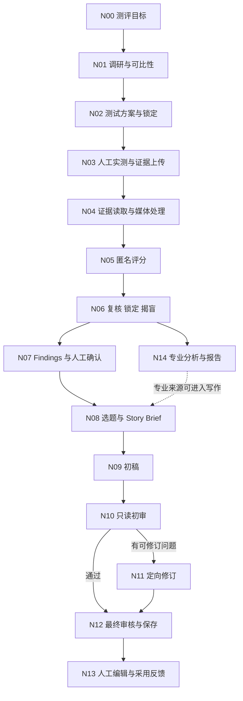

# AI 测评内容生产工作台 作品集完整方案

日期：2026-10-16。面向 AI 产品经理求职。项目基线：`codex/quick-backend-workflow` / `e306e67`。

## 1. 核心结论与交付范围

每个节点都应有目标、输入输出、验收要求、失败处理和可观测记录；评估方式按任务选择。文件保存用完整性校验，写作用有依据的质量标准，评分器用独立人工校准。节点评估与整条链路评估同时存在，不能把各节点通过率相乘当成最终可采用率。

这份方案把当前产品、待补设计和待运行实验分开，形成求职展示的内容蓝图。它不是已完成实验的报告，也没有修改生产流程或执行付费模型调用。

| 配套材料 | 作用 |
| --- | --- |
| [节点设计与评测标准](节点设计与评测标准.md) | N00–N14 的输入输出、规则、评估、异常与人工分工 |
| [模型选型与效果评估方案](模型选型与效果评估方案.md) | 数据集、人工标准、实验、指标、准出与结果模板 |
| [已有证据盘点](../AI-Benchmark-Studio-作品集证据盘点.md) | 已有实现、历史观察、职责草稿及缺口；保留用户原有编辑 |
| [生产提示词清单](../ai-prompt-inventory.md) | 实际任务配置、输入结构与 Prompt 版本 |
| [生成失败 Bad Case 复盘](生成失败BadCase复盘.md) | 原始报错截图、根因、修复验证与失败记录归档 |

**完成这份方案，意味着设计有了完整定义；完成作品集成果页，还需要真实素材、评测结果和本人确认的决策复盘。**

## 2. 项目定位与业务背景

**作品集标题建议：AI 测评内容冷启动——从业务需求到可追溯的内容生产工作流。**

业务背景来自本人说明：36氪AI测评网处于起步阶段，需要增加测评文章供给；人工写手成本高，质量也未达到预期，希望用 AI 辅助生产，在控制成本的同时维持基础质量。原人工流程的费用、工时、周产量及稿件样例尚待补证。

主要用户先聚焦内容生产者与编辑。平台读者是最终受益者，但未经访谈和行为数据验证，不能声称已经证明留存或阅读增长。

**问题定义：**帮助内容生产者把真实产品体验与原始材料整理成可采用文章，减少重复调研、组织和改写工作，同时保留事实核对与人的判断。

**目标假设：**相对同范围的人工旧流程，在内容质量不低于既定验收线的条件下，降低单篇可采用文章的综合成本，并增加可持续的内容供给。是否达成，由实验与业务记录判断。

业务链路应展示两张图：原流程“查资料—设计任务—实测—整理材料—写作—编辑”，以及工作台流程。标出人仍需承担的实测、确认和编辑工作，不能把这些人工投入从成本中漏掉。

## 3. 状态与证据约定

| 标签 | 允许的表述 | 证据要求 |
| --- | --- | --- |
| 已有实现 | 已支持、已配置、已建立机制 | 当前源码、界面、软件测试与可追溯版本 |
| 历史观察 | 某次样本或某轮验证中观察到 | 时间、输入范围、实际配置、原输出与限制；复盘文档是索引 |
| 待补设计 | 建议这样记录或验收 | 方案定义，尚不能说已经上线 |
| 待验证 | 尚不能得出效果结论 | 数据集、标注、原始运行与统计结果待补 |

当前可以讲完整流程、模型任务分工、评分与人工纠偏、证据约束、失败恢复。模型最优、总体幻觉下降、规模化降本和业务增长均需补证。历史版本不能被新规则重写为“当时已经做到”。

简历项目原时间为2026.08–2026.09。作品集如展示10月新增的视频处理和后台迭代，明确标注“后续个人迭代至2026.10”，并由本人确认归属；实习时间不随之延长。

## 4. 产品方案与关键取舍

| 决策 | 项目中的选择 | 应解释的依据与代价 |
| --- | --- | --- |
| 产物定位 | 社区文章为主要产物，报告与评分提供内部材料 | 有结构的报告不必然成为好文章；读者要理解具体任务、结果与适用范围 |
| 执行方式 | 人工操作被测产品并上传真实证据 | 保留实际体验和证据真实性，也保留实测的人工成本 |
| 工作流控制 | 预设阶段、明确人工节点、后台任务接力 | 阶段可追溯；复杂度和调用链会增加，应通过实际效果证明必要性 |
| 模型分工 | 检索、分析、写作和视觉理解分别配置 | 以能力与任务约束建立初始方案，最终选型仍需要质量/成本/耗时对照 |
| 质量控制 | 程序校验、模型审核、人工确认组合 | 模型审核会漏检和误杀，需要独立标注；多次调用同一模型不等于独立事实来源 |
| 快速/专业 | 快速模式减少操作，专业模式保留完整复核与报告 | 两类路径均保留既定锁定、盲评、评分不可变和审计规则 |

作品集至少展示两个被比较的可行方案。例如“直接用聊天模型写稿”与“基于实测证据的工作流”，说明增加证据与审核步骤的原因；只有同任务实验完成后才能说哪种方案效果更好。

## 5. 完整工作流

这是产品级逻辑图，不要求媒体处理只在全流程运行一次；实际读取通过现有服务和缓存按需发生。专业报告不阻塞已确认 Findings 的快速写作路径。异常状态停在对应阶段，不能通过图中的箭头跳过验收。

当前正常写作是 Brief、初稿、初审、最终审核四阶段；有问题才增加一次定向修订，选题发现另计。不得把历史“无条件语言编辑”当成当前流程。[现有生成服务](../../lib/services/publish.service.ts)。

## 6. 节点的共同设计要求

所有节点在[节点附录](节点设计与评测标准.md)使用同一张设计卡：

1. 任务目标与谁负责。
2. 输入来源、必要字段、版本与不应收到的信息。
3. 输出结构、来源关系、允许为空和明确失败的含义。
4. 硬规则：格式、引用、权限、不可变记录等。
5. 软质量：相关性、可执行性、事实支持、表达与读者价值。
6. 验证方法、记录口径和未通过后的动作。

**验收不等于每节点都打总分。**格式通过不能抵消事实错误；可读性高不能抵消虚构经历；模型 confidence 不是经过校准的正确概率。

建议补充一份统一运行记录，覆盖 nodeId、runId、projectId、上游版本、输入签名、实际 Provider/模型/Prompt、开始结束时间、尝试数、输出、错误分类、人工动作和 token/费用状态。现有各业务记录与 generationTrace 已有部分字段，统一导出和汇总仍属待补设计。不得保存厂商私有思维链、密钥或可公开访问的签名文件链接。

## 7. 模型与 Prompt 方案如何展示

主作品集只放一张分工图和一个真实决策案例；完整配置放附录。所有版本以实际调用审计为准，不把仓库默认值写成已核对的线上值。

- 产品检索与事实整理：先检索，再限定来源整理。
- 测试方案、文本评分与结果分析：分析任务路由。
- 正文、标题及受限修订：写作任务路由。
- 图片/PDF 与视频关键帧：视觉理解；视频先形成结构化证据。
- 原始证据核验：根据实际输入模态选择路由；“独立审核阶段”不意味着模型供应商独立。

Prompt 附录采用“职责、输入信任边界、输出 Schema、证据规则、未知处理、失败与修复”六块结构，挑一个真实改动做前后对照。不要把整份提示词堆在主作品集中。候选模型与推理强度的实验方法见[评估附录第4节](模型选型与效果评估方案.md#4-模型与工作流对照实验)。

## 8. 效果与业务指标

| 层级 | 核心问题 | 指标和边界 |
| --- | --- | --- |
| 业务 | 产出是否值得采用、是否降低成本 | 可采用率、单篇可采用内容综合成本、人工编辑工时、固定周期采用篇数 |
| 整链路 | 是否稳定得到符合标准的结果 | 首次任务成功率、重试后成功率、等待与操作时间、人工接管比例 |
| AI 节点 | 哪一步造成错误或退化 | Research 主张支持、Protocol 可执行、Judge 人工一致性、Findings 有据性、文章质量 |
| 审核器 | 有没有漏放和误拒 | 漏检率与误杀率，基于独立人工标注，正常与错误材料都覆盖 |
| 工程 | 是否正确保存和恢复 | 版本/证据一致、失败状态、重启恢复、权限和历史保护 |

每个比率同时给分子、分母、样本来源、周期、版本和失败处理口径；小样本不包装成稳定服务水平。定义、成本公式和结果表在[评估附录](模型选型与效果评估方案.md)。

## 9. 作品集的完整页面安排

建议主稿14页，技术与评测细节另附。页数是内容预算，可合并；每页只有一个核心判断、一个图或例子和必要说明。

| 页 | 必须回答的问题 | 放什么 | 目前状态 |
| --- | --- | --- | --- |
| 01 | 你做了什么，为谁解决什么问题 | 项目一句话、本人角色、真实产品与成果边界 | 项目存在；角色表述本人确认 |
| 02 | 为什么要做 | 内容冷启动、人工旧流程、费用/工时/稿件证据 | 背景已有；量化基线待补 |
| 03 | 什么叫成功 | 质量底线、内容采用、综合成本指标树 | 完整设计；结果待测 |
| 04 | 为什么选这条产品路径 | 备选方案、MVP范围与优先级 | 决策文档已有；个人决策过程待复盘 |
| 05 | 人和AI如何协作 | 主流程与确认节点，标明快/专业支线 | 已实现，以当前界面为证据 |
| 06 | 每一步怎么保证可用 | 选取Research、Protocol、写作三张节点卡 | 本方案已定义，实际效果待评估 |
| 07 | 为什么这样分配模型 | 任务/模态/预算分工，以及一组对照结果 | 分工已有；统一实验待运行 |
| 08 | 怎样评价模型和整条链 | 数据集划分、人工标准、节点与端到端评测 | 已设计；样本与标注待补 |
| 09 | 如何控制事实风险 | 原文到主张的关系、只读审核、人工确认与漏检案例 | 机制和历史Bad Case已有 |
| 10 | 一次质量问题如何推动决策 | 错误原句、原始证据、根因假设、修复和回归 | 历史复盘可用；原件整理待补 |
| 11 | 如何处理能力或资源限制 | 视频解析失败到证据处理，展示未知边界 | 10月后续迭代，历史单样本观察 |
| 12 | 产品是否真的有效 | 人工旧流程/当前版/候选版同口径结果表 | 待测；不能放假数字 |
| 13 | 如何上线与持续改进 | 真实界面、后台恢复、版本追溯、采用反馈计划 | 多数机制已有；运营统计待补 |
| 14 | 你的贡献与判断是什么 | 本人/ Codex 分工、三次关键取舍、局限与下一步 | 项目协作已说明；归属本人复盘 |

面试时间有限时，主讲02、04、07、09、10、12六页；被追问时再打开节点和评测附录。未完成的实验页写“实验设计与当前证据”，不放效果柱状图冒充结果。

## 10. 两个主案例与后续案例

**主案例A：内容审核误放行。**从历史 v21–v24 的人工发现切入，展示原文、错误句和判断依据，再解释原文约束、事实边界与当前审核职责。跨版本改动分时间轴，不把多轮补丁写成一次成功实验。复盘入口：[事实约束记录](../publish-grounding-repair.md)。

**主案例B：流程从逐步操作到后台接力。**说明哪些动作可以自动化、哪些必须交给人；用一个真实任务展示失败发生在哪、成功阶段如何复用、旧文章如何保留。上线与恢复记录能证明机制，但节约工时和费用仍需测量。复盘入口：[后台流程](../quick-workflow.md)、[验收记录](../quick-workflow-review.md)。

**后续案例C：视频解析限制。**展示供应商解析失败、预处理与证据消费的取舍；解释ASR尚未接入、关键帧不能证明全片连续动作等限制。真实单样本观察不等于视频任务整体效果。复盘入口：[媒体证据](../video-media-evidence.md)。

**后续案例D：重新生成连续失败。**从两张真实报错截图切入，区分截图读取结构错误、任务串写、审核误拦截与上游图片解析失败；展示节点契约、审核意见定位、版本隔离和三项目回归。失败记录从 App 清理后，仍保留本地原始备份及作品集证据，评估统计继续计入失败。复盘入口：[生成失败 Bad Case 复盘](生成失败BadCase复盘.md)。

每个案例都准备“问题—影响—备选方案—本人判断—实现—验证—剩余问题”七项。本人不记得的决策过程保留待确认，不凭源码补写心理活动。

## 11. 实施顺序与交付验收

| 顺序 | 工作 | 明确产物 | 结束条件 |
| --- | --- | --- | --- |
| A 已有 | 本地证据与能力盘点 | 已有证据文档、职责草稿 | 实现与效果不混用 |
| B 本次 | 完整设计与展示方案 | 本文、节点卡、评估方案 | 所有节点有接口、标准、异常与测量；标注现状 |
| C 下一步 | 素材整理与人工标准 | 去敏原文/稿件、样本清单、标注标准、业务基线 | 来源可追溯，清楚哪些是真实/合成与哪些可外发 |
| D 另行执行 | 最小离线与任务对照 | 运行记录、盲评、成本与错误结果表 | 固定划分、含失败、保留不利结果，不改历史 |
| E 最后 | 展示稿与面试演练 | 可投递作品集、备查附录、讲述稿 | 关键成果有证据，本人能解释方案与权衡 |

不要求先补齐全部节点的大规模统计才开始作品集。先用一个完整真实案例贯穿各节点，再优先评估写作、审核和端到端采用；根据真实薄弱点扩展Research、Protocol与Judge验证。本轮已经完成B的方案定义，不声称C–E已经完成。

## 12. 是否新开 Codex 聊天

本轮建议继续在当前聊天确定方案，因为业务起点、真实产品边界和已有证据已在这里。新聊天本身不会自动提高内容质量。

当目标变成独立的版式制作或评测执行，可以在同一项目中另开聊天，并先读取这三份方案及项目规范；需要保留对话背景时可考虑分叉。官方远程工作流文档将分叉描述为继承历史、用于尝试不同方向：[Codex上下文管理说明](https://developers.openai.com/blog/mastering-codex-remote-for-engineering)。这里是工作组织建议，不要求新建聊天。

可给后续聊天的交接指令：

> 继续制作AI Benchmark Studio的AI产品经理作品集。先按项目AGENTS.md阅读核心规范，再阅读docs/portfolio/作品集完整方案.md及两份配套附录、已有证据盘点。业务目标为AI测评网内容冷启动与单篇可采用内容综合成本控制。区分已有实现、历史观察、待补设计和待验证。先整理真实样例与人工标准，再决定实验与展示稿；不得编造访谈、量化效果或团队协作，不修改历史实验，不把工作流写成自主Agent。涉及当前任务之外的真实模型调用时，先列明待发送材料、实验规模和预算。简历原项目8–9月与10月后续迭代分开说明。

## 13. 方法参考与产品事实来源

评估按任务选程序检查、模型辅助和人工判断，并同时看节点与最终结果；模型评分需人工校准。参考：[Anthropic评估实践](https://www.anthropic.com/engineering/demystifying-evals-for-ai-agents)。工作流和Agent按运行控制方式区分，选择复杂度应服务任务。参考：[Building Effective Agents](https://www.anthropic.com/engineering/building-effective-agents)。这两项用于方法参考，具体节点、指标与实验设计为本项目方案。

项目事实以[产品规范](../../PRODUCT_SPEC.md)、[决策记录](../../DECISIONS.md)、[当前任务配置](../../lib/ai/config.ts)、[迭代日志](../../PLAN.md)及相关原始记录为准。本方案不替代生产规范，不直接改变既定产品规则。
