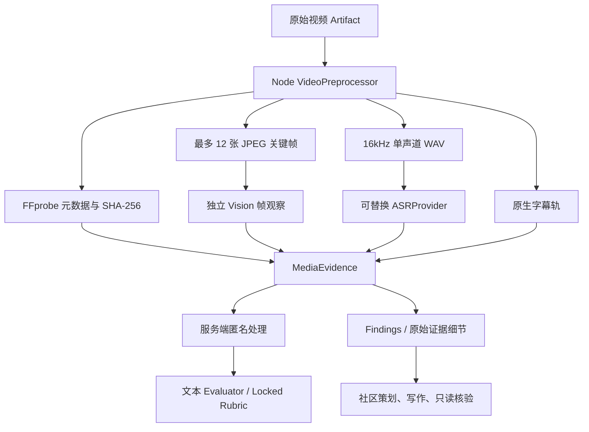

# 视频媒体证据架构

更新：2026-10-11。适用：`video-evidence.v1`。不覆盖历史实验、评分或文章。

## Root Cause / Before

上传已采用浏览器直传私有 Supabase Storage，DB 记录原始 Artifact；上传成功不等于 AI 能解析 MP4。

旧 Judge、Findings 和 Publish 使用带签名的原始视频 URL，视觉 Provider 必须下载、解码视频并同时理解业务任务。智谱返回 1210 媒体解析错误时，Provider Adapter 抛出 AIProviderError；Service 将整次 Judge/Findings/Publish 标记 failed。缺少媒体预处理和可降级证据，所以一个 MP4 解析失败阻断全部后续环节。

## After

MP4 不发送给任何 AI。Router 会拒绝 native video_url 与伪装成 file_url 的 MP4/MOV/WebM。原始输入、预期结果、MediaEvidence 与辅助截图观察进入评价。截图/PDF 的非视频主流程继续使用既有多模态路由，不变成无依据文本评分。

## 模块与数据

- `lib/media/video-preprocessor.ts`：可迁移的处理接口，流式读取文件、完整性检查、元数据、资源预算、临时目录清理。
- `ffmpeg.ts`：无 shell 子进程；协议限 file/pipe、容器限 MOV/MP4/Matroska/WebM/AVI，禁止从播放列表向外下载。失败日志不暴露 Storage 签名 URL。
- `frame-extractor.ts`：短视频约每 4 秒、最长 12 帧；长视频均匀覆盖首、中、尾。JPEG 最宽 960 像素、每帧最多 1 MB，串行解码控制内存。
- `audio-extractor.ts`：WAV PCM16、mono、16kHz；无音轨正常。超过 300 秒暂不提取音频，明确 skipped，不把局部转录冒充全片。
- `transcript.ts`：ASRProvider 接口和运行时 schema；当前项目没有 ASR API，默认 unavailable。接入必须在服务端组合层配置 Provider，业务代码不写死模型。音频提取失败/超时与 ASR 失败有警告，不推断“产品没有配音”。
- `subtitles.ts`：提取第一条原生字幕轨，解析 SRT/VTT 的时间与原文；无字幕正常，位图字幕/不可提取字幕降级为 warning。烧录字幕由关键帧 visibleText 提取。
- `frame-analyzer.ts`：每批最多 4 帧，经 AI Task Service → Router → 智谱视觉 Adapter；严格检查唯一、已提供的 timestamp。失败批次拆成单帧，坏帧跳过。整体 100 秒，单次视觉模型 30 秒，取消信号传到底层 HTTP。
- `media-evidence.ts`：严格 MediaEvidence schema、九项评价约束和可解释的媒体错误。保留 Artifact ID、源 SHA、采样时间、观察、转录、字幕、warnings、Provider/model/promptVersion/签名与使用量。
- `screenshot-evidence.ts`：视频 Case 的辅助截图先形成带原 Artifact ID 的可追溯观察，Evaluator 不直接读取二进制。
- `video-evidence.ts`：证据汇总；私有 Storage 缓存预处理结果、成功转录和完整证据。相同 Artifact/hash/policy 不重复抽帧；任务上下文、路由、ASR 配置变化会生成不同语义缓存。带失败警告的部分证据只在 10 分钟窗口内复用，主动重试绕过部分缓存。
- `media-attempt.ts`：快速模式的可选媒体失败作为独立 degraded 记录；续跑跳过失败批次/帧，主动 retry 会重试。失败记录绝不冒充成功 AI 输出。成功视觉结果沿用 quick_job_steps。

MediaEvidence 的完整审计 telemetry 保存在缓存和服务端 quick_job_steps 中；DB 只保存结构化观察，不保存 JPEG/WAV。续跑读取本轮已完成证据，即使 Storage 缓存故障也不重复解码；显式重试使用独立 retryEpoch。发给模型的文本剔除 createdAt/latency 等易变信息，防止部分失败后的续跑不断使下游 checkpoint 失效。

## 评分和文章边界

新的集中路由 `video_frame_analysis` 使用现有 `glm-4.6v` 做观察，`judge_video_evidence` 使用现有 `deepseek-v4-pro` 做文本证据评价。这是明确的任务职责拆分，不是智谱失败后静默切换供应商。一个 TestCase 的所有 Sample 仍共享一个 immutable JudgeCaseRun 路由。

视频 Case 的已知产品名称、官网 URL/域名在数据库内脱敏，不向应用返回 Blind Mapping。新增 server-only RPC `redact_video_judge_evidence`，只允许 service_role、运行中的 JudgeRun、匹配 TestCase 和 Locked Protocol。原 Artifact、历史 AI Score 与 Review Event 均不改写。

Findings 和 Publish 共用 MediaEvidence，取消 Publish 额外的 native MP4 读取。文章只能使用实际提取的内容与已确认发现；没有 ASR 时禁止评价配音质量/声画一致性；抽样帧不能证明连续动画流畅、全片无空镜或全片字幕正确。分析工具的失败不能算作产品缺陷，无法观察的项降低 confidence 并标记未知。

## 错误与运行预算

无音频、无字幕、ASR 不可用/失败、部分抽帧/视觉失败、缓存故障都继续使用有效证据。完全没有有效画面/转录/字幕、且没有有效辅助原始证据，才报 no_evidence。无法读取、损坏文件明确报错。评分模型本身不可用仍需失败并重试，不生成替代评分。

MVP 资源边界：文件最多 50 MiB；Storage 下载最多 120 秒，与最多 60 秒 CPU 解码预算分开；ASR 最多 30 秒；最多 12 帧。超过容量或服务器缺少二进制属于部署/资源错误，要求独立处理端，不能描述成产品失败或伪造完成结果。快速任务每轮最多解码一个未缓存视频、执行一个未缓存 AI 阶段，通过持久化阶段续跑。

## Vercel 部署

运行于 Node 24，而非 Edge。`ffmpeg-static` 和 `@ffprobe-installer/ffprobe` 在安装时按平台取二进制；postinstall 验证版本、执行权限和二进制总体积，Next output tracing 显式包含 Linux x64 binary。不能把开发机的 macOS binary 用于 Linux prebuilt 部署。

原视频仍浏览器直传 Storage，不经过 Vercel 4.5 MB 请求体。仅服务端从 Storage 读取，临时文件写入 /tmp 并 finally 删除。后台 API maxDuration 300 秒；管理员专用 `/api/media/runtime` 用无用户数据的小夹具实际编码、probe、抽帧、提音，验证云端运行环境。

标准 Functions 部署还受函数包总体积、内存、临时磁盘和执行时间限制。二进制大小检查不是函数包完整体积证明，必须结合远端 build 与 runtime 诊断。长视频、多视频并发、高分辨率或大文件应把 VideoPreprocessor 实现迁至独立 Node/容器工作端；上层 Evidence/Evaluator 接口无需改变。

官方参考：[Functions limits](https://vercel.com/docs/functions/limitations)、[Function runtime](https://vercel.com/docs/functions/runtimes/node-js)、[Private Storage](https://supabase.com/docs/guides/storage/buckets/fundamentals)。

## 验证与已知限制

验证结果见本次 PLAN Progress Log。真实用户视频测试只读原文件、向视觉模型发抽帧 JPEG、向评价模型发证据文本，输出保存在本地 `/private/tmp/video-evidence-live/`，不写回历史评分或文章。

端到端夹具使用真实 FFmpeg 与 Supabase/Storage，AI 响应明确来自隔离 Provider。生产全局 worker 排除保留名称 `[E2E]%`；测试 worker 必须显式选择自己的夹具项目，避免生产 Cron 抢占尚未发布代码的本地验证任务。

ASR 尚未配置，这是明确的能力缺口；不能宣称已完成声音实测。关键帧采样不能替代完整时序/动画检测。缓存位于私有 bucket，当前不自动删除历史 derivative；未来需按 Artifact 保留策略增加清理/配额。模型对观察和证据的语义判断仍需人工复核，结构正确不等于事实绝对正确。没有引入跨厂商自动 fallback。
